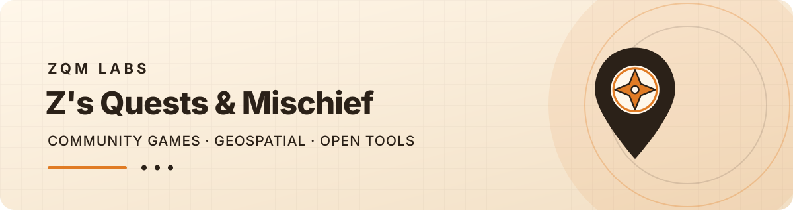

  

# ZQM Labs — Z's Quests & Mischief

  
  
  

  <strong>Games, gear & a little mischief.</strong> 
  Location-based scavenger-hunt games for neighborhoods, schools, churches, scout troops, and office parties — now in 8 languages across 6 continents.

  <a href="https://zqmlabs.com">🌐 zqmlabs.com</a> •
  <a href="https://zqmlabs.com/games/hunt-for-wisps/">🎮 Play Demo</a> •
  <a href="https://github.com/ZQM-Labs/quest-packs">📦 Quest Packs</a> •
  <a href="https://github.com/ZQM-Labs/quest-authoring">✍️ Author Your Own</a>

---

## 🎮 What We Build

### Wisp's Lost Lanterns

Our flagship game — a self-guided QR scavenger hunt with 6 stops, 4 scare levels, and a global leaderboard.

- **Player PWA** — offline-first, GPS-enabled, QR-code unlocks, 8 languages
- **Quest Packs** — ready-to-play kits with printable signs, setup guides, and FAQs
- **Authoring Tools** — create your own quests with our validator and guide

### Open-Source Geospatial Patterns

14+ repos of production-tested geospatial patterns — PostGIS, H3, STAC, GDAL, GeoPandas, DuckDB, COG, and more.

## 🌍 Global Reach

| Feature | Status |
|---|---|
| Languages | EN, ES, FR, DE, PT, ZH, JA, AR |
| Story Modes | Halloween, Lantern Festival, Summer Solstice, Spring Equinox, Diwali, Mid-Autumn |
| Cultural Adaptations | East Asian, South Asian, Western, Latin American, Middle Eastern, African |
| Global Leaderboard | Cross-kit rankings with country flags |
| Community Discovery | Find games near you |

## 📚 Key Repos

| Repo | Description |
|---|---|
| [lantern-player](https://github.com/ZQM-Labs/lantern-player) | Wisp's Lost Lanterns player — offline-first PWA |
| [zqmlabs-site](https://github.com/ZQM-Labs/zqmlabs-site) | Public website (Hugo) |
| [quest-packs](https://github.com/ZQM-Labs/quest-packs) | Ready-to-play quest packs |
| [quest-authoring](https://github.com/ZQM-Labs/quest-authoring) | Create your own quests |
| [organizer-toolkit](https://github.com/ZQM-Labs/organizer-toolkit) | Setup guides and FAQs |
| [playtests](https://github.com/ZQM-Labs/playtests) | Playtest protocols and results |
| [geospatial-patterns](https://github.com/ZQM-Computing/geospatial-patterns) | Umbrella index of all 14+ geospatial repos |

## 🏗️ ZQM Computing — the geospatial arm

[ZQM Computing](https://github.com/ZQM-Computing) is the geospatial engineering arm of ZQM Labs. They build the patterns, data infrastructure, and tooling that ground our games in real-world locations.

## 📜 License

All repos are MIT-licensed unless otherwise noted. Game content (quests, stories, characters) is CC-BY-4.0.

---

  <em>Play more. Plan less.</em> 
  <a href="https://zqmlabs.com">zqmlabs.com</a>

